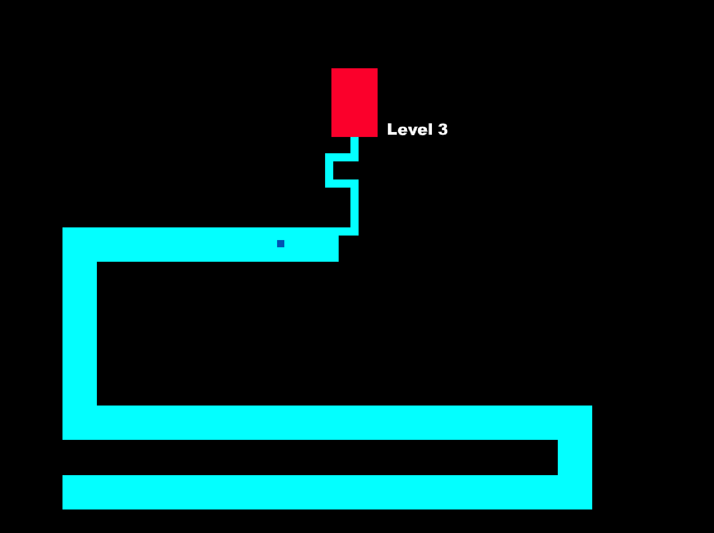

# The Maze
#### Reimplementation of 2003 prank game "The Maze" using Raylib.

Made with [Raylib 5.5](https://www.raylib.com/) using C.  
Distributed under MIT License.

**[Jump to Compilation Instructions](#compilation)**  
**[Jump to Customization of the Endcard](#custom-image-and-sound)**

<hr>

Main Menu             |  Gameplay
:-------------------------:|:-------------------------:
  |  

<hr>

## Compilation

- #### Prerequisites for Windows
    - **MSYS2** with MINGW64 -- *[Download From Here](https://www.msys2.org/) if not installed*
    - **GCC** for MINGW64 -- *Run `pacman -S mingw-w64-x86_64-gcc` on **MSYS2 Terminal** if not installed*
    - **Make** for MINGW64 -- *Run `pacman -S make` on **MSYS2 Terminal** if not installed*

- #### Prerequisites for macOS
    - **Xcode Command Line Tools**  -- *Run `xcode-select --install` on **Terminal** if not installed*


- #### To compile on Windows, run:
    `$ make win` or `$ make`

- #### To compile on macOS, run:
    `$ make osx`

On success, you should see the executable at `_dist/`. 

The executable is entirely self-contained, so you can ship it on its own, without needing any external files.

## Custom Image and Sound
You can easily replace the audio and image files. They will be embedded into the executable file during build time. The steps are as follows:

- Replace the files **[endcard.png](./custom_assets/endcard.png)** and **[sound.wav](./custom_assets/sound.wav)** with yours. 
    - Be sure that your files have the exact same names.
    - Be sure that the **endcard.png** is **800x600**.
    - Be sure that the audio is no longer than **10 seconds.**

- Compile the code normally by running `make (osx)` (see the Compilation Instructions).

The resultant executable will have all the assets baked into it. Don't worry about the other files. Just take the executable and you should be good to go.

## Clear the `dist` directory
```
make clear
```

## Clear the `_temp_do_not_ship_can_delete` directory
If nothing goes wrong during compilation, you shouldn't be seeing this directory. But if you see it, you can delete it by calling the following:
```
make cleartemp
```

## Check the supported architectures of the executable and the library for the macOS:
```
make lipo
```